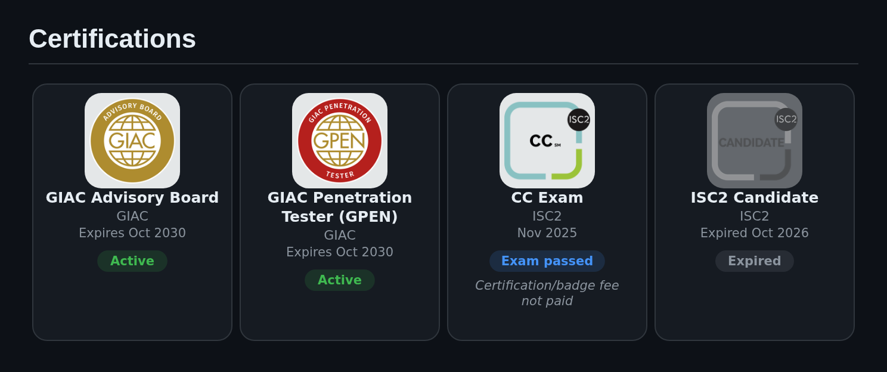
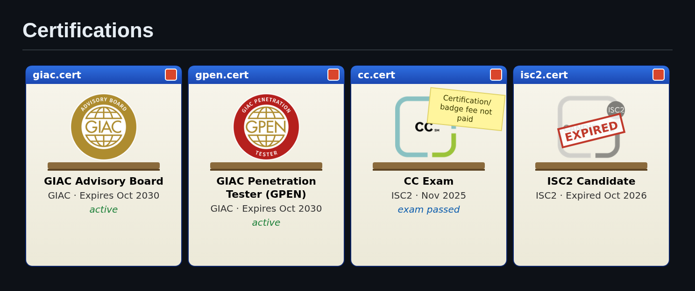

# certshelf

Clickable certification tiles for your GitHub profile README, from Credly and anything Credly doesn't have.

<p align="center">
  
</p>

<details>
<summary><code>style: retro</code></summary>
<p align="center"></p>
</details>

- Every Credly badge, active or expired, links to its verification page.
- Add your own entries, with an image, a link and a note.
- `card` (dark and light) or `retro` style. It only commits when something changes.

## Usage

1. Mark where the tiles go in your README:

   ```html
   <!-- certshelf:start -->
   <!-- certshelf:end -->
   ```

2. Add a workflow. This example ([examples/workflow.yml](examples/workflow.yml)) runs once a month:

   ```yaml
   permissions:
     contents: write
   steps:
     - uses: actions/checkout@v4
     - uses: teodoramz/certshelf@v1
       with:
         credly: teodor-amzuloiu
         extra: |
           - name: CC Exam
             issuer: ISC2
             date: 2025-11-18
             status: Exam passed
             note: Certification/badge fee not paid
             image: https://images.credly.com/images/2859c37a-015b-40a6-b570-4bdd7e849b05/image.png
             link: certs/cc-exam-passed.png
   ```

| Input | Default | |
| --- | --- | --- |
| `credly` | | Your Credly username, from `credly.com/users/<username>` |
| `style` | `card` | `card` or `retro` |
| `extra` | | Entries that aren't on Credly. Keys: `name`, `issuer`, `date`, `status`, `note`, `image` (a URL or a path in your repo), `link`, `expires` |
| `readme` | `README.md` | The file with the markers |
| `folder` | `certshelf` | Where the tile images go |
| `commit` | `true` | Commit and push the changes |

## License

MIT
